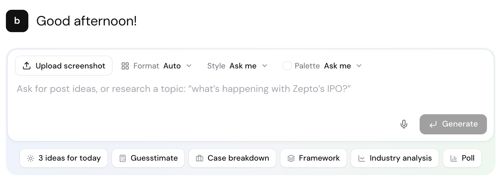
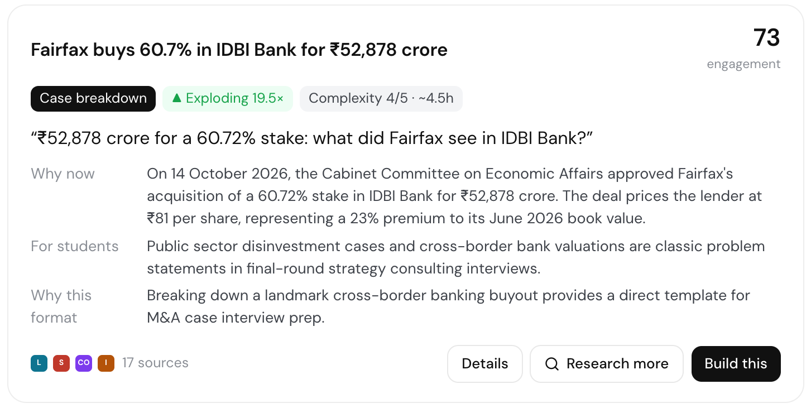
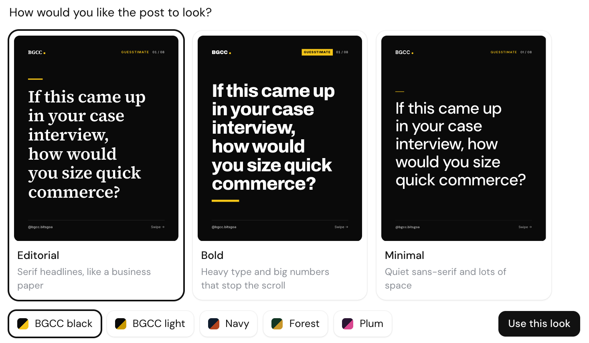
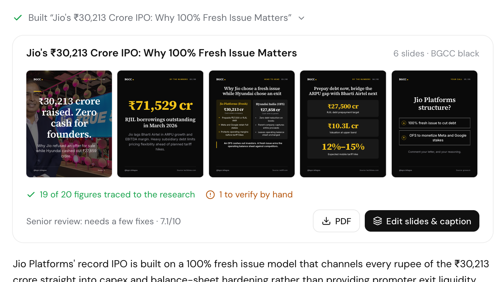
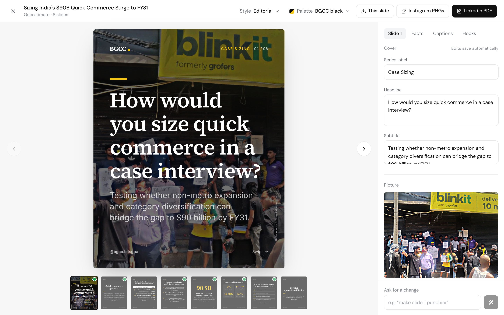
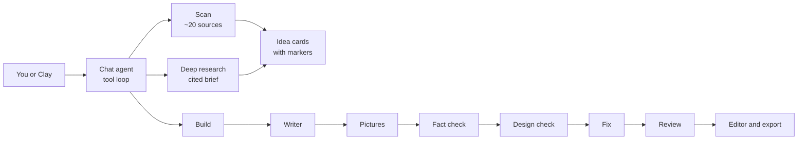
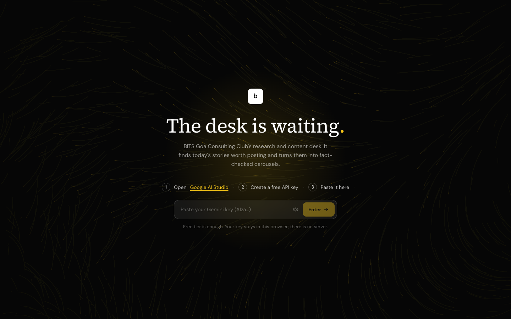

<div align="center">


# BGCC Desk

**A research and content desk for BITS Goa Consulting Club.**
It scans the business news for what is trending, suggests post ideas with every marker a content lead needs, and builds the chosen idea into fact-checked carousel slides for Instagram and LinkedIn.

Runs entirely in the browser · free Gemini tier · bring your own key · no server, no account

</div>



## What it does

| You ask | The desk does |
|---|---|
| **"3 ideas for today"** | Scans about 500 stories from about 20 sources, Indian and global (Economic Times, Mint, FT, BBC, CNBC, TechCrunch, Google News, Hacker News, Google Trends), groups them into stories, measures momentum and returns scored idea cards. |
| **"What's happening with Zepto?"** | Deep research: 5 planned searches, a gap check, up to 3 follow-ups, then a cited brief and 3 post ideas. |
| **"Build this"** | Researches again, writes the slides and both captions, finds real pictures, fact-checks every number, looks at the rendered slides and fixes what it finds, then a second model reviews it. |
| **"Make slide 3 punchier"** | Revises the post in place. |
| **Screenshots of BGCC posts + "learn our tone"** | Updates the voice profile every post is written in. |
| **Talk to Clay** | Live voice chat with the same tools. Whatever Clay makes shows up in the chat. |

## Every idea comes with its markers



| Marker | How it is worked out |
|---|---|
| **Trend relevance** | The triggering event and its date. A momentum badge (Rising, Exploding) compares the last 3 days with the prior 2 weeks. |
| **Content format** | A rule-based router picks guesstimate, case breakdown, framework, industry analysis, poll or short analysis, and says why. |
| **Audience relevance** | Why it matters to the audience: about 70% possible clients (founders, business leaders) and 30% students. |
| **Engagement potential** | A 0 to 100 score from five parts, each with its evidence: momentum (Wikipedia pageviews, Hacker News), discussion, source breadth, format track record and audience fit. A grade says how much is measured rather than assumed. |
| **Execution complexity** | 1 to 5, with estimated hours and what is still needed. |
| **Suggested hook** | Plus three alternatives and the reviewer's pick. |
| **Source references** | Links to the original coverage behind every claim. |

## How a post is built





The model never draws slides. It picks from over 20 designer-made layouts (charts, tables, 2x2 matrices, assumption trees, timelines, funnels and more) and fills in their fields, and code renders them. Seven steps run live in the chat:

1. **Research** a fresh fact brief, with numbered sources.
2. **Plan and write** a storyboard first, then the slides, a LinkedIn caption and an Instagram caption, in BGCC's voice.
3. **Pictures.** Where a real photo helps, candidates come from the articles' own photos, image search, Wikipedia and Commons, and a vision model picks the best one per slide.
4. **Fact check.** Every number is extracted and matched to the brief in code. Only the ones that don't match go to a model. Guesstimate maths is computed in code, never by the model.
5. **Design check.** The deck is rendered off-screen exactly as it exports. Code measures overflow, long headlines and the tells of generated copy (stock words, clichés, Title Case). A vision model then critiques the slides in separate passes and scores them.
6. **Fix.** Fact and design problems go back to the writer as one revision. A fix that adds a wrong number is rolled back.
7. **Review.** A senior reviewer on a different model scores the post ship, fix or kill.

The editor edits every slide, chart, table, picture and caption, shows the fact check, and exports Instagram PNGs or a LinkedIn PDF. Three styles (Editorial, Bold, Minimal) default to BGCC's black, white and yellow.



## Architecture



- **Browser only.** React 19, Vite, Tailwind and TypeScript. Keys, ideas and chats live in IndexedDB.
- **Gemini free tier.** Each job uses the cheapest model that does it well (Flash-Lite for planning and vision, Flash for writing). A quota ledger tracks each model's daily limit and moves to the next model when one runs out.
- **Built for marketing.** Every prompt starts from the same goal: grow BGCC's page and win it projects. About 70% of readers are possible clients (founders, business leaders) and 30% are students, so a good post makes a founder think of hiring the club and a student save or share it, not just one that is accurate. The reviewer scores that pull.
- **Two models disagree on purpose.** The reviewer runs on a different model from the writer, so it doesn't approve its own work.
- **Code over model wherever possible.** Format routing, engagement scores, number matching, guesstimate maths and layout measurement are all deterministic.
- **Optional relay.** Indian news sites block browser requests, so a tiny Cloudflare Worker (`relay/worker.js`) forwards feeds. The dev server has one built in.
- **Clay** is real-time 3D (three.js) with a clay texture, and talks over Gemini Live.

## Run it

```bash
npm install
npm run dev        # http://localhost:5173
```



You need a free Gemini API key; nothing else costs money. Open Settings, paste a free key from [Google AI Studio](https://aistudio.google.com/apikey), and ask for ideas. `npm run build` makes a static site you can host anywhere. To host it, import the repo into Vercel: the feed relay ships as `api/relay.js`, so it works with no setup. Elsewhere, deploy `relay/worker.js` to Cloudflare Workers and paste its URL in Settings.

<details>
<summary><b>Code map</b></summary>

```
src/lib/agent.ts      chat agent: tools, prompt, tool loop
src/lib/pipeline.ts   ideas for today: scan, cluster, measure, research, write
src/lib/research.ts   deep research and the citation registry
src/lib/scoring.ts    format router and engagement score
src/lib/build.ts      build and revise a post
src/lib/writer.ts     slide writer, fact briefs, reviewer, guesstimate maths
src/lib/factcheck.ts  number extraction and matching
src/lib/design.ts     off-screen render, measurement, vision critique
src/lib/taste.ts      copy rules and design critique
src/lib/images.ts     finding and picking pictures
src/lib/gemini.ts     API client, quota ledger, fallbacks
src/lib/live.ts       voice session
src/slides/           layouts, styles, export
src/components/       chat parts, idea cards, Clay
relay/worker.js       optional feed relay
```
</details>

**Privacy.** Only public material (news, public posts) is sent to Gemini. Don't paste member data or client work.
